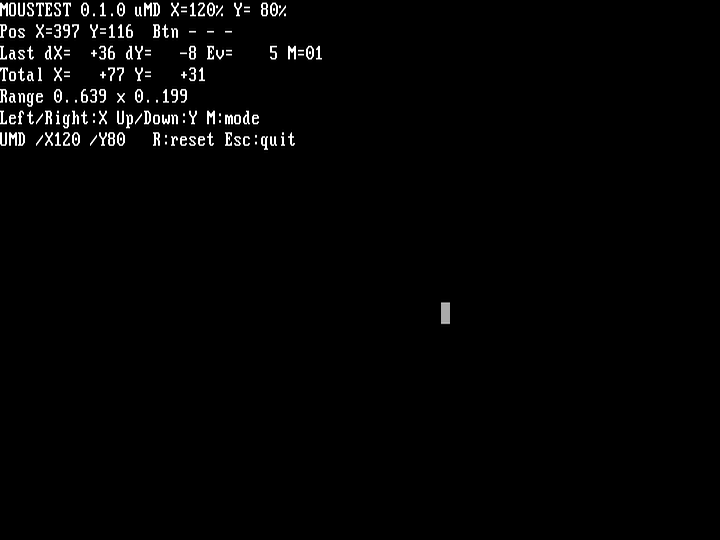
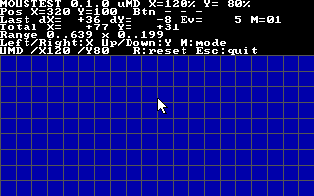

# μMD

**Eternal betaware**

μMD (Micro Mouse Driver) is a tiny mouse driver for DOS. It works well with [μCDD](https://github.com/vorvek/uCDD).

## Download

μMD comes as two drivers. Each [release](https://github.com/vorvek/uMD/releases) has one package for each. Download the one for your mouse:

| Package | Driver | Mouse |
| --- | --- | --- |
| `umd-<version>-ps2.zip` | `UMD.COM` | PS/2 mouse port |
| `umd-<version>-serial.zip` | `UMDCOM.COM` | Serial mouse on COM1 to COM4 |

Both packages contain `MOUSTEST.EXE`.

## Requirements

- A 286 or later and DOS 3.3 or later. `LH` needs DOS 5.
- `UMD.COM`: a PS/2 mouse port with BIOS support (INT 15h, AH=C2h). Two or three buttons are supported.
- `UMDCOM.COM`: a serial mouse on COM1 to COM4 that speaks the Microsoft, Logitech, or Mouse Systems protocol. The port needs an 8250, 16450, or 16550 UART.

## Setup

Copy `UMD.COM` into a directory and add it to `AUTOEXEC.BAT`. Can be safely loaded high.

```dos
LH C:\UMD\UMD.COM
```

If using it with μCDD, load the mouse driver first. The resident part uses 2,800 bytes.

## Usage

```text
UMD [/X<n>] [/Y<n>] [/S<n>] [/U]
```

| Option | Effect |
| --- | --- |
| `/X<n>` | Set the horizontal sensitivity to n percent (10 to 400). |
| `/Y<n>` | Set the vertical sensitivity to n percent. |
| `/S<n>` | Set the same sensitivity for both axes. |
| `/U` | Remove μMD from memory. |

Run `UMD` with `/X`, `/Y`, or `/S` again to change the installed driver. `UMD /?` prints the help.

## UMDCOM

`UMDCOM.COM` is the serial mouse driver. It has the same INT 33h functions, pointer, and sensitivity options as `UMD.COM`. The resident part uses 3,040 bytes.

```dos
LH C:\UMD\UMDCOM.COM
```

Without options, UMDCOM looks for a mouse on COM1 to COM4 and takes the first port that answers. The mouse tells the driver whether it is a Microsoft or a Logitech mouse. A Mouse Systems mouse does not answer, so it needs `/Z`.

```text
UMDCOM [/C<n>] [/I<n>] [/M | /3 | /Z] [/X<n>] [/Y<n>] [/S<n>] [/U]
```

| Option | Effect |
| --- | --- |
| `/C<n>` | Use COM port n (1 to 4). Default: the first port with a mouse. |
| `/I<n>` | Use IRQ n (2 to 7). Default: 4 for COM1 and COM3, 3 for COM2 and COM4. |
| `/M` | Use the Microsoft protocol, two buttons. |
| `/3` | Use the Logitech protocol, three buttons. |
| `/Z` | Use the Mouse Systems protocol, three buttons. |
| `/X<n>`, `/Y<n>`, `/S<n>` | Sensitivity, as for `UMD`. |
| `/U` | Remove μMD from memory. |

With `/M`, `/3`, or `/Z`, the driver installs on the given port, or on the first port that exists, even when no mouse answers. Without them, `UMDCOM` stops with `No serial mouse found.` when no mouse answers.

## MOUSTEST

`MOUSTEST.EXE` is a small debug tool used to see if the driver is actually working, and will allow you to fine tune your mouse sensitivity. It works with both drivers and shows which one is installed. The arrow keys change the sensitivity of the installed driver immediately, and the driver keeps the new values after you quit. The screen shows the `UMD` options that make them permanent in `AUTOEXEC.BAT`.

| Key | Effect |
| --- | --- |
| Left, Right | Horizontal sensitivity down, up |
| Up, Down | Vertical sensitivity up, down |
| M or Tab | Change between text mode and VGA mode |
| R | Set the counters to zero |
| Esc | Quit and print the `UMD` options |

<table>
  <tr>
    <td align="center" width="50%">
      <strong>Text mode</strong><br>
      <a href="docs/moustest-text.png"></a>
    </td>
    <td align="center" width="50%">
      <strong>VGA mode 13h</strong><br>
      <a href="docs/moustest-vga.png"></a>
    </td>
  </tr>
</table>

## Build

See [BUILDING.md](BUILDING.md) and [tests/README.md](tests/README.md).

## License

GPL-3.0-only. See [LICENSE](LICENSE).
